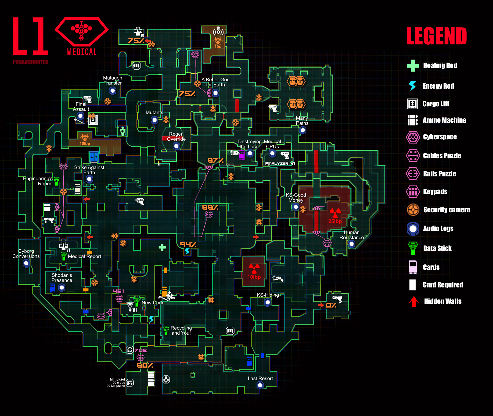

# System Shock Remake

# Sub-pages
- [Puzzles](https://pcgamehunter.github.io/games/sysstem-shock-remake/puzzles)

# Notes
- All ranged weapons have modes that can be swapped by T
	 - The pulse pistol has 3 modes with increasing power/cost!
	 - Ballistic weapons switch ammo type instead.
- Shooting cameras and CPU nodes reduces level security
	- This unlocks new areas
	- This does **not** impact respawns, respawning does seem limited up to a point.
	- Destroying CPU nodes often spawns a wave of enemies!
- In Executive there is a second "Laser Rapier". That changes color to match your UI color choice in settings. This is permanent and is set once, when picked up. So before you pick it up, figure out which color you want change the rapier to be, pick it up and then set the UI back to what you actually want.

# Medical
 

# Research
- Go through the teleporter to access the resurrector immedietly.

# Executive
- Flashing codes: 232, 347, 692, 137
- 347 is used to enter a room
